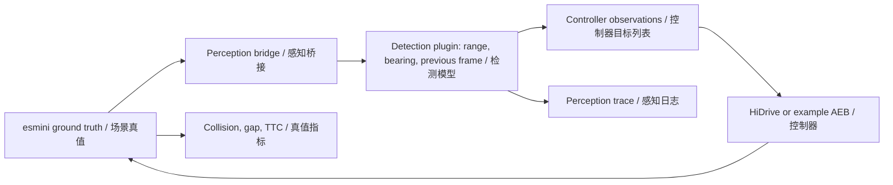

# 空间 Markov 检测误差模型 v1 / Spatial Markov detection error model v1

## 模型 / Model

**中文。** [`detection_spatial_v1`](../pipeline/errors/detection_spatial_v1.py) 在目标列表层模拟连续漏检。对每个目标，模型使用当前感知帧的真值中心距离 $r_t$（m）、目标中心相对自车朝向的方位角 $\theta_t$（°）和上一感知帧的检测结果 $D_{t-1}$。$D_t=1$ 表示目标出现在当前感知帧中，$D_t=0$ 表示目标漏检。

**English.** [`detection_spatial_v1`](../pipeline/errors/detection_spatial_v1.py) simulates consecutive misses at the object-list level. For each target, the model uses the current sensor frame's true centre-to-centre range $r_t$ (m), bearing $\theta_t$ (°) relative to the ego heading, and the previous sensor frame's detection outcome $D_{t-1}$. $D_t=1$ means the target is present in the current observation list, and $D_t=0$ means it is missed.

$$
\begin{aligned}
x_r &= \max(0,r_t-r_0), \qquad x_\theta = \max(0,|\theta_t|-\theta_0),\\
p_t &= \min(0.5,p_0 + a_r x_r + a_\theta x_\theta),\\
T_{\mathrm{miss},t} &= T_0 \exp(k_r x_r + k_\theta x_\theta),\\
\beta_t &= \frac{\Delta t_{\mathrm{sensor}}}{T_{\mathrm{miss},t}}, \qquad
\alpha_t = \frac{p_t}{1-p_t}\beta_t \quad (p_t>0).
\end{aligned}
$$

| 条件 / Condition | 本帧检出概率 / Probability of detection in the current frame |
| --- | ---: |
| 首帧或历史不连续 / First frame or gap in history | $1-p_t$ |
| 上一帧漏检 / Missed in the previous frame | $\beta_t$ |
| 上一帧检出 / Detected in the previous frame | $1-\alpha_t$ |

**中文。** 在固定几何下，$p_t=\alpha_t/(\alpha_t+\beta_t)$ 是长期漏检比例，$T_{\mathrm{miss},t}$ 是平均连续漏检时长。代码先用 [`markov_parameters`](../pipeline/errors/frames.py) 算出基础转移概率，再把 $\alpha_t$ 和 $\beta_t$ 乘以相同的指数因子。固定 $p_t$ 时，恢复变慢会使漏检段开始得更少、持续得更久。几何随时间变化时，整条轨迹的实际漏检比例取决于逐帧转移。配置使 $p_t=0$ 时，辅助函数规定 $\alpha_t=0,\ \beta_t=1$。

**English.** At fixed geometry, $p_t=\alpha_t/(\alpha_t+\beta_t)$ is the stationary miss fraction and $T_{\mathrm{miss},t}$ is the mean duration of a consecutive miss. The code computes the baseline transitions with [`markov_parameters`](../pipeline/errors/frames.py) and scales both by the same exponential factor. At fixed $p_t$, slower recovery gives fewer, longer miss episodes. With changing geometry, the observed miss fraction depends on the sequence of frame transitions. For $p_t=0$, the helper sets $\alpha_t=0,\ \beta_t=1$.

| 参数 / Setting | 符号 / Symbol | 批量实验值 / Batch value |
| --- | --- | ---: |
| `base_miss_rate` | $p_0$ | 0.10 |
| `range_start_m` | $r_0$ | 20 m |
| `angle_start_deg` | $\theta_0$ | 5° |
| `range_slope_per_m` | $a_r$ | 0.0025 m⁻¹ |
| `angle_slope_per_deg` | $a_\theta$ | 0.005 deg⁻¹ |
| `miss_mean_s` | $T_0$ | 0.5 s |
| `recovery_range_decay_per_m` | $k_r$ | $\ln(2)/10$ m⁻¹ |
| `recovery_angle_decay_per_deg` | $k_\theta$ | $\ln(2)/10$ deg⁻¹ |
| `sensor_period_s` | $\Delta t_{\mathrm{sensor}}$ | 0.05 s |

**中文。** Piazzoni 等人的两项研究分别给出了稳态概率与持续时间的两状态建模思路，以及按距离、方位角和遮挡划分转移概率的方法。上表的阈值、斜率和指数衰减系数是本项目的敏感性实验设定，尚未用实测传感器数据标定。 [IJCAI 2020 §5.1](https://www.ijcai.org/Proceedings/2020/0483.pdf) · [PEM §V-B，式 (5)–(7)](https://arxiv.org/pdf/2302.11919#page=6)

**English.** Piazzoni et al. motivate using stationary probability and state duration as two model parameters, and conditioning transitions on spatial and visibility partitions. The thresholds, slopes and exponential decay coefficients above are sensitivity assumptions that await calibration with measured sensor data. [IJCAI 2020 §5.1](https://www.ijcai.org/Proceedings/2020/0483.pdf) · [PEM §V-B, Eqs. (5)–(7)](https://arxiv.org/pdf/2302.11919#page=6)

## 数据流 / Data flow



**中文。** esmini 每 0.01 s 通过桥接把自车和目标的真值发送给 Python。插件每 0.05 s 对每个目标抽样一次，抽样由 seed、感知帧号和目标 ID 决定。同一感知帧内的五个控制步复用检测结果。漏检时，插件把目标标记为 `seen=False`，桥接在该控制步隐藏该目标。控制器得到准确的自车状态和经过检测门控的目标列表。控制步结束后，桥接恢复目标真值，碰撞、间距和 TTC 使用仿真真值计算。检测插件单独启用时，检出的目标保留原始位置、尺寸和类别。

**English.** At each 0.01 s control step, the bridge sends true ego and target states from esmini to Python. The plugin draws once per target every 0.05 s using the seed, sensor frame index and target ID. The five control steps in that frame share the detection outcome. A missed target is marked `seen=False` and the bridge hides it during the controller step. The controller receives exact ego state and the resulting target list. The bridge restores target truth after the controller step, and collision, gap and TTC use simulation truth. With detection as the sole plugin, reported targets retain their original position, size and class.

## 运行与输出 / Running and outputs

**中文。** Python 的 `SETTINGS` 定义默认值，JSON 中 `errors` 对象的字段覆盖默认值。`seed` 控制本次的随机抽样，`seeds: 100` 在批量配置中展开为 0–99。当前单次配置显式启用空间漏检和空间恢复。从仓库根目录运行以下命令，首次使用先完成 [运行环境安装](../README.md)。

**English.** Python's `SETTINGS` provides defaults. The JSON object in `errors` overrides them. `seed` controls one run's random draws and `seeds: 100` expands to seeds 0–99 in a grid. The single-run configuration enables both spatial effects. Run these commands from the repository root after [initial setup](../README.md).

```bash
python -m pipeline run configs/detection_spatial_v1_seed18.json --output output/spatial_v1_recovery_seed18 --no-plots
python -m pipeline grid experiments/detection_spatial_v1_100.json --list
python -m pipeline grid experiments/detection_spatial_v1_100.json --workers 8
```

| 文件 / File | 内容 / Content |
| --- | --- |
| `config.json`, `versions.json` | 实际参数和代码版本 / Resolved settings and code provenance |
| `perception_applied.tsv` | 感知帧号、距离、方位角、$p_t$、上一帧检测状态、条件检出概率和本帧漏检标志 / Sensor frame, range, bearing, $p_t$, previous detection, conditional detection probability and miss flag |
| `observations.csv`, `ego.csv` | 目标观测与自车运动 / Target observations and ego motion |
| `summary.json`, `metrics.csv` | 碰撞、制动时间和真值安全指标 / Collision, braking times and truth-based safety metrics |
| 批量 / Grid `results.csv`, `summary.csv` | 每次运行与每组汇总 / Per-run results and group summaries |

**中文。** 批量配置覆盖三个 TASC 场景、HiDrive 和 `example_aeb`、三种误差模型，每组 100 个 seed，共 1,800 次。原生 AEB 另用旧实验的 esmini 原生控制器及本地适配器。该适配器在每个理想传感器帧运行同一个 Python 插件，并从原生 AEB 的目标列表删除漏检对象。下表包含这额外的 900 次实验。

**English.** The grid covers three TASC scenarios, HiDrive and `example_aeb`, and three error models with 100 seeds per group, for 1,800 runs. The additional 900 native AEB runs used the historical esmini controller and a local experiment adapter. The adapter calls the same Python plugin for each ideal sensor frame and removes missed objects from the native AEB's input list. The table includes those native AEB runs.

## 三场景结果 / Three-scenario results

碰撞次数，每组 100 次。IID 使用 10% 漏检率，固定 Markov 使用 10% 稳态漏检率和 0.5 s 平均连续漏检时长。

Collision counts per 100 runs. IID uses a 10% miss probability. Fixed Markov uses a 10% stationary miss fraction and a 0.5 s mean miss duration.

| TASC | 控制器 / Controller | IID | 固定 Markov / Fixed Markov | 空间 Markov / Spatial Markov |
| --- | --- | ---: | ---: | ---: |
| 1549178 | HiDrive | 0 | 6 | 6 |
| 1549178 | Native AEB | 0 | 8 | 8 |
| 1549178 | `example_aeb` | 0 | 2 | 2 |
| 1554254 | HiDrive | 0 | 12 | 14 |
| 1554254 | Native AEB | 1 | 9 | 10 |
| 1554254 | `example_aeb` | 0 | 3 | 3 |
| 1554431 | HiDrive | 100 | 100 | 100 |
| 1554431 | Native AEB | 100 | 100 | 100 |
| 1554431 | `example_aeb` | 0 | 3 | 2 |

**中文。** 2,700 次均完成。1554254 和 1554431 的 OpenDRIVE 末段长度与声明的道路总长度不一致，已核对车辆轨迹远离该路段。批量最大绝对方位角约 1.68°，低于 5° 阈值，本批检验了距离项在这些设定下的作用。详细运行数据保存在本地批量结果目录。

**English.** All 2,700 runs completed. The OpenDRIVE files for 1554254 and 1554431 report a mismatch between the last segment and the declared road length. The checked vehicle trajectories stayed far from those segments. The maximum absolute bearing was about 1.68°, below the 5° threshold, so this batch exercised the range terms under the stated assumptions. Detailed traces are in the local batch output.
